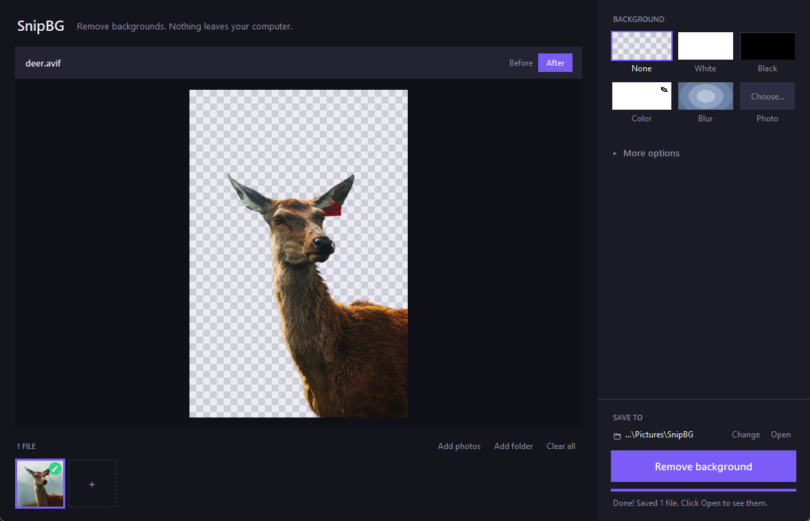

<div align="center">


# SnipBG

**Remove photo backgrounds in one click. Nothing ever leaves your computer.**

[](https://github.com/KeithClemmons/SnipBG/releases/latest)
[](https://github.com/KeithClemmons/SnipBG/releases)


[**⬇ Download SnipBG**](https://github.com/KeithClemmons/SnipBG/releases/latest)

<br>



</div>

<br>

## Why SnipBG?

Most background removers make you upload your photos to someone else's server, then charge per image. SnipBG runs a state-of-the-art AI model **right on your machine**: free, private and unlimited.

- 🔒 **Private.** Your photos never leave your computer. No account, no uploads, works offline.
- ✨ **Clean edges.** Powered by [InSPyReNet](https://github.com/plemeri/InSPyReNet), which handles hair, fur and fine detail well.
- 📂 **Batch friendly.** Drop in one photo or a whole folder, and subfolders are kept.
- 🎨 **Instant restyling.** Swap the background, add a shadow or a sticker outline, and the preview updates instantly with no re-processing.
- 🎞️ **GIFs and video too.** Cut out animated GIFs, MP4 and MOV files frame by frame.

## Get it

Grab the file for your computer from the **[latest release](https://github.com/KeithClemmons/SnipBG/releases/latest)**:

| | Download |
|---|---|
| **Windows** 10/11 | `SnipBG-Setup-x.y.z.exe` (installer) or the `windows-portable.zip` |
| **Mac** (M1 or newer) | `SnipBG-x.y.z-macos-arm64.dmg`. Open it and drag SnipBG to Applications. |
| **Linux** (x86-64) | `SnipBG-x.y.z-linux-x86_64.tar.gz`. Extract it, then run `SnipBG/SnipBG`. |

> [!NOTE]
> SnipBG isn't code-signed yet, so the first launch shows a warning.
> On **Windows**, click **More info → Run anyway**. On **Mac**, open **System Settings → Privacy & Security** and click **Open Anyway**.
> The first background removal also downloads the AI model (~350 MB), once.

## How it works

1. **Drop** photos or folders onto the window.
2. **Pick a background**: transparent, white, black, any color, a blur of the original, or another photo.
3. Hit **Remove background**. Done. Click **Open** to see your files.

Use **Before / After** to compare, and the ← → keys to flip through photos. Right-click a thumbnail to remove it or find the saved file.

<details>
<summary><b>More options</b></summary>
<br>

Tucked away under **More options** in the sidebar:

| | |
|---|---|
| **Effects** | Drop shadow (below, angled or glow), clean edges, center subject, sticker outline |
| **Size** | AI upscale 2× / 3× / 4×, resize to an exact size like `1080x1080` |
| **Output** | PNG or WebP, file size, file naming, save the alpha mask, add a watermark |
| **Quality** | Best or Fast model, NVIDIA GPU acceleration |
| **Video & GIF** | Process every frame or skip some for speed; transparent MOV or green-screen MP4 |

Your settings and output folder are remembered for next time.

</details>

<details>
<summary><b>FAQ</b></summary>
<br>

**Is anything uploaded?**
No. Everything runs locally. The only internet connection SnipBG ever makes is a one-time download of the AI model.

**Why is the first photo slow?**
The AI model downloads and loads on first use. After that, each photo takes several seconds on a typical CPU, or faster with an NVIDIA GPU when running from source.

**What file types does it open?**
JPG, PNG, WebP, AVIF, HEIC/HEIF (iPhone photos), BMP, TIFF, animated GIFs, and MP4/MOV/AVI/WebM/MKV video. Results are saved as transparent PNG or WebP.

**Does it work on video?**
Yes, if [ffmpeg](https://ffmpeg.org/download.html) is installed (Windows: `winget install Gyan.FFmpeg`). GIFs work without it.

**Intel Mac?**
Not supported. PyTorch, the AI engine SnipBG uses, no longer supports Intel Macs.

</details>

<details>
<summary><b>Run from source</b></summary>
<br>

Requires Python 3.10 or 3.11.

**Windows:** double-click `setup.bat`, then `run.bat`.

**macOS / Linux:**

```bash
python3 -m venv .venv
.venv/bin/pip install torch torchvision   # Linux: add --index-url https://download.pytorch.org/whl/cpu
.venv/bin/pip install -r requirements.txt
.venv/bin/python app.py
```

There's also a command-line version:

```bash
python cli.py ./photos -o ./output --background white
```

Run `python cli.py --help` for every option.

</details>

## Credits

Background removal by [InSPyReNet](https://github.com/plemeri/InSPyReNet) via [transparent-background](https://github.com/plemeri/transparent-background). Optional upscaling by [Real-ESRGAN](https://github.com/xinntao/Real-ESRGAN). Demo photo by [Wilson](https://unsplash.com/@wilsonch3n) on [Unsplash](https://unsplash.com).

<div align="center">
<br>
<sub>Made by <a href="https://github.com/KeithClemmons">Keith Clemmons</a></sub>
</div>
